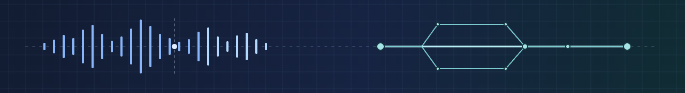

# Will

遇到一件事得反复做，我就会琢磨能不能做个小工具，让它顺手一点。

## 最近在做

### [Audio Review · 本地录音工作台](https://github.com/leilong611-ai/audio-review)

在 Mac 上转写录音，点时间戳就能回听那一段，校对后保留原音和机器稿。

[中文试用说明 ↗](https://github.com/leilong611-ai/audio-review/blob/main/README.zh-CN.md)

### [Weixin Codex Bridge · 微信与 Codex 桥接](https://github.com/leilong611-ai/weixin-codex-bridge)

把获准的微信私聊消息交给本机的 Codex，各会话独立处理。

[v0.4.0 发布说明 ↗](https://github.com/leilong611-ai/weixin-codex-bridge/releases/tag/v0.4.0)

---

**其他作品**　[今天没白活](https://github.com/leilong611-ai/JintianMeiBaihuo) · [my-slide](https://github.com/leilong611-ai/my-slide)
